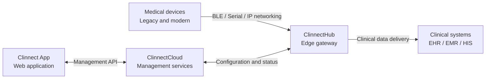

# Clinnect Health

### Medical device connectivity, from the edge to clinical systems.

Connecting legacy and modern medical equipment to the systems healthcare teams already use.

[Website](https://clinnect.health/) · [Clinnect App](https://app.clinnect.health/)

## What is Clinnect?

Clinnect is building a connectivity platform that connects existing medical equipment to electronic health record (EHR), electronic medical record (EMR), and other hospital systems. We combine **edge gateways, device integrations, and centralized management** to help healthcare organizations use the equipment they already have.

## How it works

- **ClinnectHub** communicates with medical devices at the edge and delivers data to configured clinical systems.
- **ClinnectCloud** manages gateway onboarding, configuration, and operational status.
- **Clinnect App** provides a web interface for managing gateways, devices, and integrations.

Our engineering spans embedded Linux, Yocto, and Pantavisor, with device connectivity over Bluetooth Low Energy (BLE), serial, and IP networks. Clinical integration work includes HL7 and FHIR workflows.
